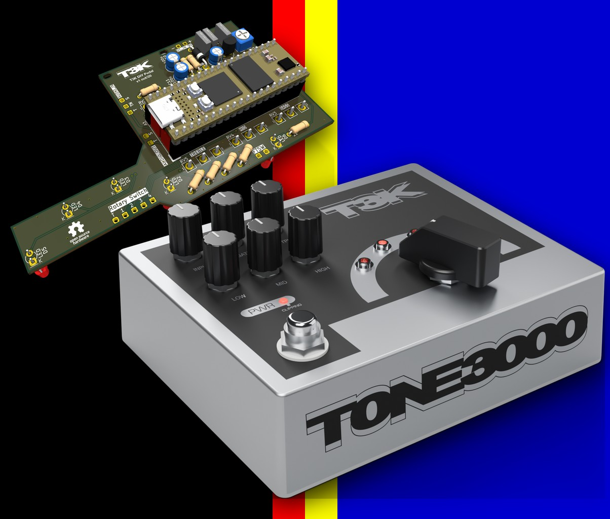
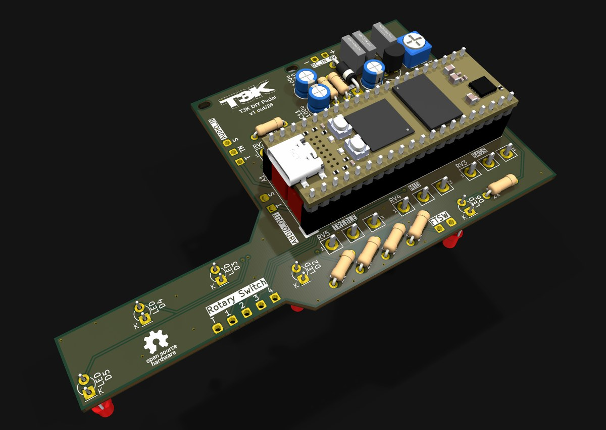
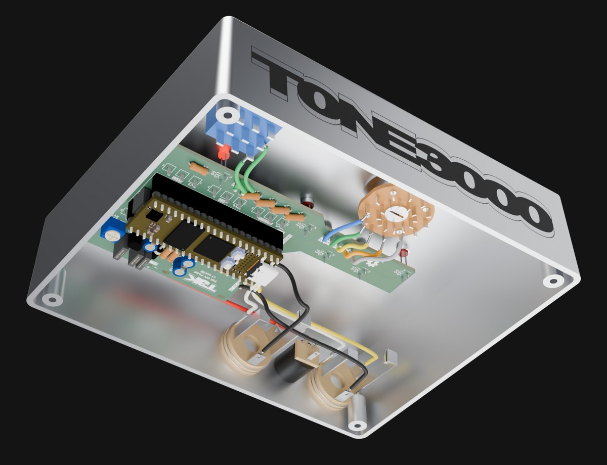

# T3K Pedal — firmware for the TONE3000 × Daisy DIY Pedal

The TONE3000 × Daisy DIY Pedal (the "T3K Pedal") is an open source guitar and bass pedal that runs
[Neural Amp Modeler](https://www.neuralampmodeler.com) A2 captures on an
[Electrosmith Daisy Seed3](https://daisy.audio/products/seed3). This repository holds everything in the kit:
the firmware, the companion web app that loads presets from [TONE3000](https://www.tone3000.com), and the
hardware (schematic, PCB, enclosure, BOM, 3D models). The step-by-step
[build guide](https://www.tone3000.com/guides/diy-pedal) walks through parts, soldering, enclosure, flashing and
loading presets.



Each of the four presets on the rotary selector is a one- or two-block chain:

- **Block 1** — a NAM **A2-Lite** capture
- **Block 2** — another A2-Lite capture (a drive pedal into an amp, a preamp into a power amp) **or** a cabinet IR

Signal chain: input → noise gate → INPUT level → [input calibration] NAM [hand-off | loudness normalize]
→ ([input calibration] NAM 2 [loudness normalize] | cab IR, unity in-band) → 3-band EQ → OUTPUT level.
Bypass is a clean digital pass-through. See [Gain staging](#gain-staging).

Inference uses the A2-Lite Cortex-M7 engine from [tone-3000/embedded](https://github.com/tone-3000/embedded)
(a git submodule at `embedded/`, pinned to a release): dependency-free C with generated Thumb-2/FPv5 kernels for
the A2-Lite WaveNet architecture. The engine's output on the pedal is bit-for-bit identical to
NeuralAmpModelerCore's at float32 rounding level (max abs error 2.4e-7, ESR −135 dB on the engine's golden test).

## Repository layout

| Path | Contents |
| --- | --- |
| `t3k_pedal.cpp`, `t3k_pedal.h`, `eq3band.h`, `Makefile` | Firmware (libDaisy, `BOOT_QSPI` app) |
| `.github/workflows/` | CI: firmware build and release binaries |
| `libDaisy/` | Electrosmith libDaisy (submodule, pinned to a release) |
| `embedded/` | A2-Lite engine and `.namb` reader (submodule) |
| `daisyConvol/` | VZtec's partitioned convolver for cab IRs (submodule, pinned to v0.1.0) |
| `app/` | Companion web app: TONE3000 login, preset builder, WebUSB flashing — see [`app/README.md`](app/README.md) |
| `pack_models.py`, `convert_ir.py`, `pydfu.py` | Command-line preset bank builder and flasher |
| `hardware/` | KiCad project, Gerbers, BOM, enclosure drill/print files, 3D models, renders — see [`hardware/README.md`](hardware/README.md) |
| `docs/images/` | Images used in this README |

## Hardware

The `hardware/` directory has everything to build the pedal: the KiCad project and Gerbers, the bill of materials
with Tayda and Electrosmith links, the 1590XX enclosure drill template and faceplate artwork, 3D models of the pedal
and board, and the renders used in the build guide.

| | |
| --- | --- |
| [](hardware/renders) | [](hardware/pcb) |


Off-board wiring is fourteen wires (jacks, DC, footswitch, rotary); pads are labelled on the silkscreen.



## Controls

| Control | Function |
| --- | --- |
| Footswitch | Toggles the effect. Bypass is a clean digital pass-through. |
| PWR LED | On when active, off when bypassed. Flashes when the input or output clips (≥ 0.98 full scale). |
| INPUT | Level into the model, 0 to 2× (fully up is +6 dB). Noon is unity. |
| GATE | Noise gate threshold, −80 to −30 dBFS. Fully counter-clockwise disables the gate. |
| OUTPUT | Output level, 0 to 1×. |
| LOW, MID, HIGH | Three-band EQ, same curves as the plugin: low ±20 dB, mid ±15 dB, high ±10 dB. Noon is flat. |
| Rotary selector | Selects preset 1 to 4. The LED at the selected position lights. |
| Input trimmer (RV7, internal) | Analog attenuator ahead of the converter. Fully up is unity (the calibrated position, see below); back it off for hot pickups or a boost in front. |
| USB-C | Companion app connection for presets and firmware. |

## Gain staging

The pedal gain-stages each preset the way the [TONE3000 plugin](https://www.tone3000.com/guides/tone3000-plugin)
does, except that the plugin's *Calibration* setting is a constant here: the whole analog path is known.

**Input calibration.** A capture with [calibration data](https://www.tone3000.com/guides/nam-calibration) stores
the level its creator hit the gear with (`input_level_dbu`: the dBu at the gear for 0 dBFS). The pedal's own
figure is **+2.2 dBu**: with RV7 fully up, the input jack feeds a unity buffer straight into the Daisy Seed3's
converter (TI TAC5242, single-ended, 1.0 Vrms full scale), so 0 dBFS = 1.0 Vrms = +2.2 dBu at the jack. Each NAM
block is fed with `2.2 − input_level_dbu` dB of gain, and a calibrated capture responds exactly as the real gear
did to the same guitar. Captures without the data pass at unity. INPUT still adds ±6 dB on top; noon is calibrated.

**Calibrated hand-off.** When block 1 drives a second capture and carries `output_level_dbu`, its output is
scaled by `output_level_dbu − 2.2` dB instead of being normalized, and block 2's input calibration then lands on
the true level of plugging device A into device B (a pedal capture pushes an amp capture as hard as the real pedal
did). Without the data, block 1 is loudness-normalized like a last block.

**Loudness normalize.** The last NAM block is always normalized: the capture's `loudness` metadata is brought to
−18 dB, clamped to ±12 dB (unity without data). Calibration governs drive and feel; normalization governs the
listening level, so overall volume doesn't swing with each capture.

**Cab IR.** The IR is scaled to unity in-band gain: its mean power response over 100 Hz–5 kHz (log-spaced) is
brought to 0 dB, so a cab leaves the loudness of the normalized NAM block essentially unchanged and NAM-only and
NAM → IR presets sit at the same level. This differs from the plugin's IR block on purpose: the plugin
unit-energy-normalizes and then pads cabs by a fixed −18 dB, which lands ~11 dB below unity (a unit-energy cab
kernel has ~+7 dB of in-band gain) and relies on its ±24 dB block and main Out knobs to make that up. The pedal's
OUTPUT only attenuates, so that convention would leave every IR preset ~10 dB under its neighbours. Folded into the
FIR coefficients at load.

Both converters (the app and `pack_models.py` / `nam2namb`) take a capture's metadata from the top level of the
`.nam` file, which is where TONE3000 writes loudness and the calibration levels (per-submodel metadata is
deprecated and ignored). A `make LOGGING=1` build prints every staging decision at preset load.

Analog headroom note: the TL072 input buffer runs from the pedal's single +5 V rail and clips at roughly ±1 V peak
(≈ −1 dBu), about 3 dB below converter full scale. RV7 sits after the buffer, so it protects the converter, not
the buffer; a very hot signal (active pickups, a boost in front) can clip the analog stage before the PWR LED
flashes.

## Performance

Measured on the Daisy Seed3 at 480 MHz with a 48-frame block (1 ms deadline), whole audio callback including gate
and EQ, zero overruns:

| Preset | CPU |
| --- | --- |
| A2-Lite | ≈ 42 % |
| A2-Lite + cab IR (4096 taps) | ≈ 54 % |
| A2-Lite → A2-Lite | ≈ 83 % |

Engine code runs from zero-wait ITCM (copied from QSPI at boot), captures and engine instances live in DTCM, the
engine's ring buffers in AXI SRAM behind the D-cache. FPU flush-to-zero and default-NaN are enabled.

Cab IRs run on [daisyConvol](https://github.com/VZtec/daisyConvol) (MIT, git submodule), a zero-latency
non-uniform partitioned FFT convolver: 16-sample blocks (three per callback), partitions of 16 × 16 + 30 × 128
samples for a 4096-sample IR. Its engine and the CMSIS-DSP FFT also run from ITCM, its per-block state and FFT
tables live in DTCM, its stage-1 spectra and delay line (60 KB) in AXI SRAM.

## Building the firmware

Prebuilt `t3k_pedal.bin` releases are the normal route (see the build guide); the
[Firmware workflow](.github/workflows/firmware.yml) builds every push and attaches the binary to each `v*` tag's
GitHub release. To build from source you need a
complete `arm-none-eabi` toolchain — [DaisyToolchain](https://github.com/electro-smith/DaisyToolchain) or the
[Arm GNU Toolchain](https://developer.arm.com/downloads/-/arm-gnu-toolchain-downloads) — plus `dfu-util` and
`python3` with `pyserial`.

```bash
git clone --recurse-submodules https://github.com/tone-3000/NAMPedal
cd NAMPedal
make
```

libDaisy, the A2 engine and the IR convolver are git submodules pinned to releases (`libDaisy/` at v9.0.0, the
first release that knows the Daisy Seed3; `embedded/`; `daisyConvol/` at v0.1.0). The first `make` builds libDaisy's static library, after which only the
firmware rebuilds. If you cloned without `--recurse-submodules`, run `git submodule update --init --recursive`.
To build against a libDaisy checkout elsewhere, pass `LIBDAISY_DIR=/path/to/libDaisy`. `make libdaisy` rebuilds the
library, `make clean-all` cleans both.

To move a submodule to a newer release, check out the new tag inside it (`git -C libDaisy checkout vX.Y.Z &&
git -C libDaisy submodule update --init --recursive`), rebuild, and commit the submodule pointer.

`make LOGGING=1` adds a boot log, a one-shot cycle-count benchmark and a once-per-second status line over USB
serial at 115200 baud (the Daisy shows up as `/dev/cu.usbmodem*` on macOS, `/dev/ttyACM*` on Linux). Logging never
blocks: the pedal boots and runs whether or not a terminal is attached.

If `make` can't find the toolchain on `PATH`, pass `GCC_PATH=/path/to/toolchain/bin` (per invocation or exported).
A toolchain without newlib fails immediately with `fatal error: stdint.h: No such file or directory`; install one of
the two above.

## Flashing

The firmware is a `BOOT_QSPI` application, so the Daisy bootloader must be installed first.

1. Put the Daisy into DFU mode (hold **BOOT**, tap **RESET**, release **BOOT**) and run `make program-boot`.
2. Tap **RESET**. While the bootloader LED is breathing (tap **BOOT** once to make it wait indefinitely), run
   `make program-dfu`.

Once the firmware is running, you don't need the buttons: `make program-dfu PORT=/dev/cu.usbmodemXXXX` sends a reset
command over USB serial and the pedal reboots into the bootloader by itself. The companion app and `pack_models.py
--port` use the same trigger.

## Loading presets

Presets live in a separate QSPI flash region at `0x90600000`, independent of the firmware: reflash the bank to
change tones, never the firmware.

**Companion app** (`app/`, Chrome or Edge): sign in with your TONE3000 account, pick a tone for each block from the
library, preview it in the browser, then **Send DFU trigger** and **Connect and flash**. The app converts each
`.nam` to `.namb`, packs the four presets and writes the bank over WebUSB. **Sync from pedal** reads the presets
back off a plugged-in pedal (the bank stores each block's TONE3000 model id), and the app remembers your presets in
the browser between visits. See [`app/README.md`](app/README.md).

**Command line** (`pack_models.py`): same bank format, for scripting.

```bash
pip install pyusb pyserial
python3 pack_models.py --flash --port /dev/cu.usbmodemXXXX \
    "Plexi:plexi.nam@476289:greenback.wav@12345" \
    "TS > Plexi:ts808.nam:plexi.nam" \
    "Twin:twin.namb"
python3 pack_models.py --list model_bank.bin
python3 pack_models.py --dump --port /dev/cu.usbmodemXXXX   # what's on the pedal right now
```

Each argument is `NAME:NAM[:NAM2|IR]`; the second block is a capture (`.nam`/`.namb`) or an IR (`.wav`), told
apart by extension. A file may carry its TONE3000 model id as `path@ID`; the id is stored in the bank so the app's
**Sync from pedal** can find the tone again (without it the app leaves that block empty). `.nam`
files are converted with `nam2namb` from [nam-binary-loader](https://github.com/tone-3000/nam-binary-loader);
`--slim 0.0` selects the A2-Lite submodel of a slimmable `.nam`. IRs are resampled to 48 kHz, made minimum-phase,
truncated to 4096 taps (≈ 85 ms) with a Hann tail and peak normalized.

Only A2-Lite captures are accepted (1 layer array, channels 3, 23 layers, 1871 weights). Every A2 download on
TONE3000 contains A2-Lite, so any A2 capture in the library works; the firmware validates the `.namb` (CRC and
shape) before loading it. Each block is gain-staged from the capture's metadata, see [Gain staging](#gain-staging).

### Bank format (v2)

| Offset | Field |
| --- | --- |
| 0 | Header, 64 bytes: `u32 magic "NAMP"`, `u32 version = 2`, `u32 num_presets`, padding |
| 64 | `num_presets` × 64-byte entries: `char name[32]`, `u32 nam_offset, nam_size`, `u32 nam2_offset, nam2_size`, `u32 ir_offset, ir_num_samples`, `u32 nam_model_id, block2_model_id` |
| … | Blobs (`.namb` bytes, IR `float32[]`), 4-byte aligned; offsets are from bank start |

`nam_size = 0` is an empty preset (audio passes through); `nam2` and `ir` are mutually exclusive. The two model ids
are the TONE3000 model ids of block 1 and block 2 (NAM or IR), `0` when unknown; they are bookkeeping for the app
and the firmware never acts on them (they occupy what earlier v2 banks left reserved, so those banks still load and
simply report `0`). The firmware refuses banks of another version with `bank version N, firmware needs 2: reflash
the presets`.

### USB serial commands

The running firmware listens on its USB CDC port (115200 baud) for single-byte commands:

| Byte | Action |
| --- | --- |
| `D` | Blink twice and reset into the Daisy bootloader (DFU). Used by the app, `make program-dfu PORT=` and `pack_models.py --port`. |
| `B` | Print the bank directory between `T3K-BANK-BEGIN` / `T3K-BANK-END` lines: `version=2 presets=4 current=N`, then one `preset=N nam=0|1 nam_id=ID block2=nam|ir|none block2_id=ID name=...` line per preset. Used by the app's **Sync from pedal** and `pack_models.py --dump`. |

Both work in LOGGING and non-LOGGING builds.

## Troubleshooting

| Symptom | Cause | Fix |
| --- | --- | --- |
| `bank version 1, firmware needs 2` | Presets were flashed by an older app or `pack_models.py` | Reflash the presets with the current app / script |
| `namb: not a .namb file` | The bank entry is not a valid `.namb` | Regenerate the preset and reflash the bank |
| `namb: checksum mismatch` | Corrupt flash or a bad transfer | Reflash the bank |
| `namb: wrong model shape for this engine` | The capture is not A2-Lite | Use the A2-Lite submodel (`--slim 0.0`); the app only offers compatible models |
| `no preset bank at 0x90600000` / `preset is empty` | No presets loaded yet, or the rotary points at an empty slot | Load presets with the app or `pack_models.py`; check the rotary wiring |
| `libDaisy not found at libDaisy` / `fatal error: nam_a2lite.h: No such file` | Submodules not checked out | `git submodule update --init --recursive` |
| `make program-dfu` fails with "No DFU capable USB device" | Pedal not in bootloader mode | Tap RESET then BOOT while the LED breathes, or use `PORT=` |
| PWR LED flashes constantly | Input clipping | Lower INPUT, or back off the internal trimmer RV7 for hot pickups |

## About

The TONE3000 × Daisy DIY Pedal is a [TONE3000](https://www.tone3000.com) project: firmware, companion app, circuit,
PCB and enclosure. The firmware grew out of our work on
[running NAM on embedded hardware](https://www.tone3000.com/blog/running-nam-on-embedded-hardware) and the A2
architecture. [Daisy Audio](https://daisy.audio) makes the Daisy Seed3 and [Tayda Electronics](https://www.taydaelectronics.com)
bundles the kit. It's an open source pedal you build yourself; TONE3000 doesn't sell or assemble pedals, and build
support happens in the community (see the [guide](https://www.tone3000.com/guides/diy-pedal#need-help)).

## License

MIT. See [LICENSE](LICENSE).
