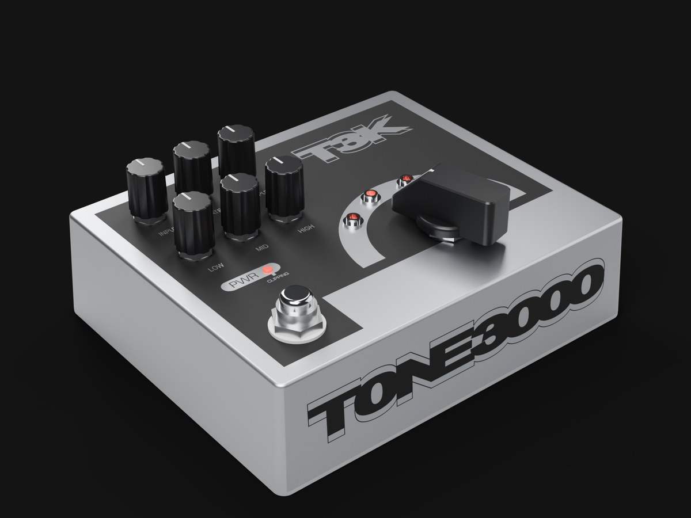
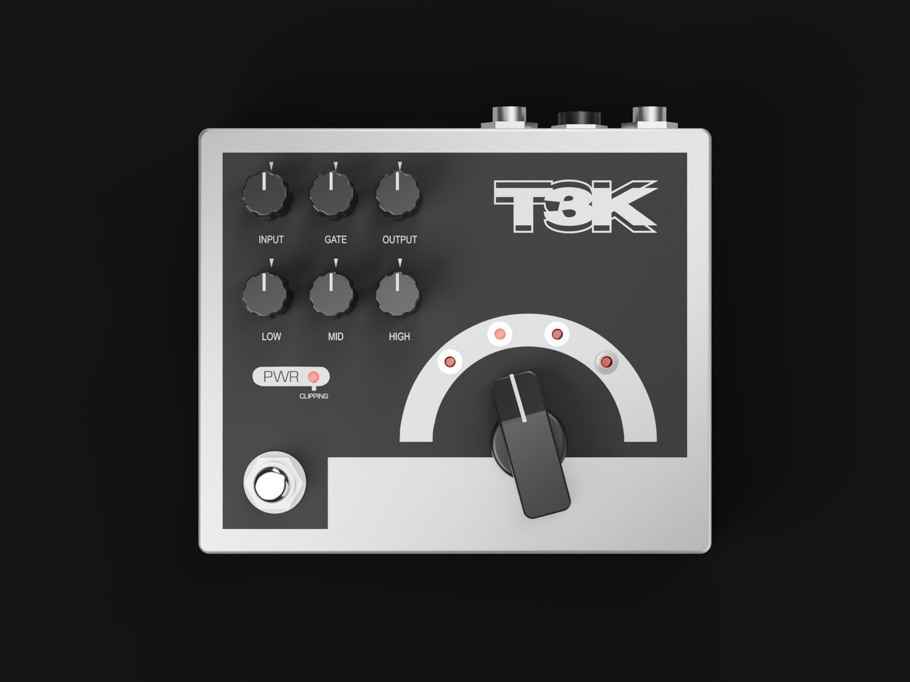
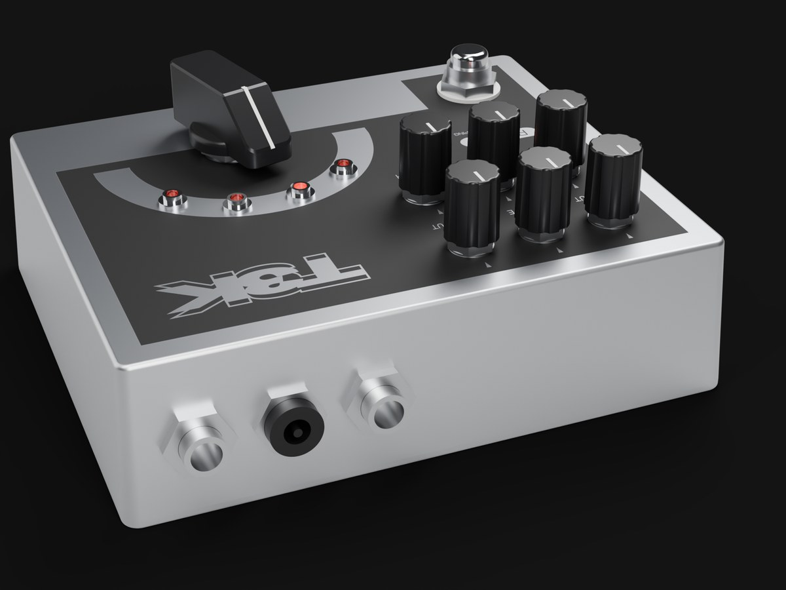
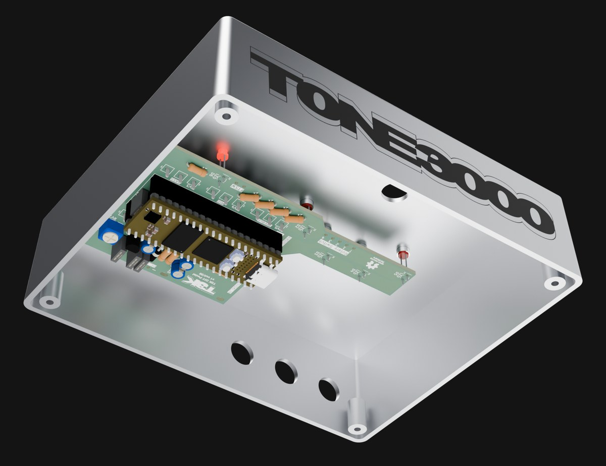

# TONE3000 DIY Pedal — hardware

Everything needed to make the pedal: the KiCad project and Gerbers, the bill of materials, the 1590XX enclosure
drill template and faceplate artwork, 3D models of the finished pedal and board, and the renders used in the
[build guide](https://www.tone3000.com/guides/diy-pedal) and the README.

All images here are renders, not photos.


## Layout

```
hardware/
├── pcb/                  KiCad 10 project, Gerbers, BOM, schematic
│   ├── nam-pedal-diy.kicad_pro / .kicad_sch / .kicad_pcb
│   ├── prj_lib.kicad_sym, prj_lib.pretty/   project symbol + footprint libraries
│   ├── 3d-models/        STEP models referenced by the project footprints
│   ├── gerbers/          Gerber X2 + Excellon drill files (and nam-pedal-diy-gerbers.zip)
│   ├── bom.csv           BOM with Tayda / Electrosmith links and prices (what to order)
│   ├── bom-kicad.csv     BOM as exported from the schematic (reference, value, footprint, qty)
│   ├── schematic.pdf
│   └── images/           schematic.svg, pcb-front / pcb-back (SVG + PNG), 3D views
├── enclosure/            1590XX enclosure: drilling + UV print
│   ├── t3k-pedal-face.ai        master artwork (Illustrator): layer "MC0" print, layer "MC1" drill
│   ├── face-artwork.pdf/.png    top face print, 141 x 117 mm (1:1)
│   ├── face-drill.pdf/.png      top face drill template, 141 x 117 mm (1:1)
│   ├── side-wordmark.pdf/.png   TONE3000 wordmark for the jack-side wall, 135 x 32 mm
│   ├── tayda-drill-1590XX.txt   Tayda custom drill service file (face + jack-end holes)
│   └── cad/enclosure.py         parametric CadQuery model of the enclosure and all hardware (exports GLB)
├── 3d/
│   ├── t3k-pedal.glb            finished pedal (enclosure, hardware, knobs, board inside)
│   └── t3k-pedal-pcb.glb        populated PCB with the Daisy Seed3
└── renders/
    ├── pedal-*.jpg, build-*.jpg, pcb-stage-*.jpg
    ├── build-animation-1080p.mp4 / -720p.mp4 / -poster.jpg
    └── src/                     Blender + CadQuery scripts that produce every render above
```

## PCB

4-layer, 1.6 mm, all through-hole. Open `pcb/nam-pedal-diy.kicad_pro` in KiCad 10 or later. The project uses its own
symbol/footprint libraries (`prj_lib.*`, registered in `fp-lib-table` / `sym-lib-table`) and the STEP models in
`pcb/3d-models/`; standard KiCad library models are referenced through `${KICAD10_3DMODEL_DIR}`.

To order boards, upload `pcb/nam-pedal-diy-gerbers.zip` to any fab. The zip contains Gerber X2 files for all copper,
mask, silkscreen and edge layers plus PTH / NPTH Excellon drill files and drill maps.

| | |
| --- | --- |
|  |  |

Regenerate the exports with `kicad-cli`:

```bash
cd hardware/pcb
kicad-cli pcb export gerbers --no-protel-ext --subtract-soldermask -o gerbers/ nam-pedal-diy.kicad_pcb
kicad-cli pcb export drill --format excellon --excellon-separate-th --generate-map --map-format pdf -o gerbers/ nam-pedal-diy.kicad_pcb
kicad-cli sch export pdf -o schematic.pdf nam-pedal-diy.kicad_sch
kicad-cli sch export bom --fields 'Reference,Value,Footprint,${QUANTITY}' --labels 'Reference,Value,Footprint,Qty' --group-by Value,Footprint -o bom-kicad.csv nam-pedal-diy.kicad_sch
```

### Off-board wiring

Fourteen wires connect the board to the enclosure-mounted parts. Pads are labelled on the silkscreen.

| Board pads | Connect to | Wires |
| --- | --- | --- |
| AUDIO IN: T, TN, S | Input jack: tip, tip-switch (normal), sleeve | 3 |
| AUDIO OUT: T, S | Output jack: tip, sleeve | 2 |
| DC IN 9V: +, − | DC jack: + to the barrel lug, − to the centre-pin lug (centre-negative) | 2 |
| FTSW (two pads) | Footswitch: common and one throw of a single pole | 2 |
| Rotary Switch: T, 1, 2, 3, 4 | Rotary switch: T to an inner-ring pin (a pole common), 1–4 to that pole's four outer-ring pins in order | 5 |


## Enclosure

Hammond 1590XX-size diecast aluminum box, drilled and UV printed. Tayda sells the pre-drilled, printed enclosure as
part of the kit; to make your own:

- **Drilling.** `enclosure/face-drill.pdf` is a 1:1 template for the top face (print at 100 %, no scaling).
  `enclosure/tayda-drill-1590XX.txt` is the file that was submitted to Tayda's custom drill service and is the
  authoritative hole list: one line per hole, `face  diameter  x  y` in mm measured from the centre of that face
  (`A` = top face, `E` = jack-end wall). Top face: 6 × 7.4 mm (pots), 12.4 mm (footswitch), 6.5 mm (rotary bushing;
  the 6→6.3 mm adapter sleeve in the BOM goes under the knob), 4 × 6.1 mm (LED bezels), 3.6 mm (power LED). End
  wall: 2 × 9.9 mm (1/4" jacks) and 10.9 mm (DC jack).
- **Printing.** `enclosure/face-artwork.pdf` (top) and `enclosure/side-wordmark.pdf` (jack-side wall) are the UV
  print files at 1:1. The master is `enclosure/t3k-pedal-face.ai`; the print and drill layers are separate layers in
  that file.
- **CAD.** `enclosure/cad/enclosure.py` is a parametric [CadQuery](https://cadquery.readthedocs.io) model of the
  enclosure with every piece of hardware (pots, rotary switch, footswitch, jacks, bezels, knobs, back plate).
  `python enclosure.py enclosure.glb` exports the GLB used by the renders and writes `enclosure.json` with the derived
  jack-wall geometry.

## 3D models

`3d/t3k-pedal.glb` and `3d/t3k-pedal-pcb.glb` are web-ready glTF binaries (open them in any glTF viewer, or
`<model-viewer>`). The full-resolution board GLB used for rendering is not committed; export it from KiCad:

```bash
kicad-cli pcb export glb --subst-models --include-tracks --include-pads --include-silkscreen --include-soldermask \
  -o hardware/3d/board-full.glb hardware/pcb/nam-pedal-diy.kicad_pcb
```

## Renders

| | |
| --- | --- |
|  |  |
|  |  |

`renders/build-animation-1080p.mp4` is the 36 s assembly animation (components onto the board, board into the
enclosure, hardware, wiring, back plate, knobs).

### Reproducing the renders

Requires [Blender](https://www.blender.org) 4.2+ (tested on 5.2), Python 3.11+ with `cadquery` and `pillow`, and
`kicad-cli`.

```bash
cd hardware
python enclosure/cad/enclosure.py enclosure/cad/enclosure.glb       # enclosure + hardware
kicad-cli pcb export glb ... -o 3d/board-full.glb pcb/nam-pedal-diy.kicad_pcb   # see above
python renders/src/make_textures.py                                 # print textures from the artwork (already committed)

# stills (Cycles). Shot names are the keys of SHOTS in render.py
Blender -b -P renders/src/render.py -- --shots final_iso,final_top,step6_top,step7_back --out renders/out
python renders/src/post.py renders/out renders/out/jpg              # crop + flatten to 1200 px JPEGs

# build animation (EEVEE, 1095 frames at 30 fps, ~1.2 s/frame at 1080p)
Blender -b -P renders/src/anim.py -- --out renders/out/anim
ffmpeg -framerate 30 -i renders/out/anim/f_%04d.png \
  -vf "fade=t=in:st=0:d=0.5,fade=t=out:st=35.8:d=0.7,format=yuv420p" \
  -c:v libx264 -preset slow -crf 22 -movflags +faststart -an renders/build-animation-1080p.mp4
```

`renders/src/wires.py` holds the off-board wiring as 3D polylines (used by both the wiring stills and the animation);
`hero_compose.py` composes the pedal and board cut-outs on the TONE3000 striped background for the hero/card images.
